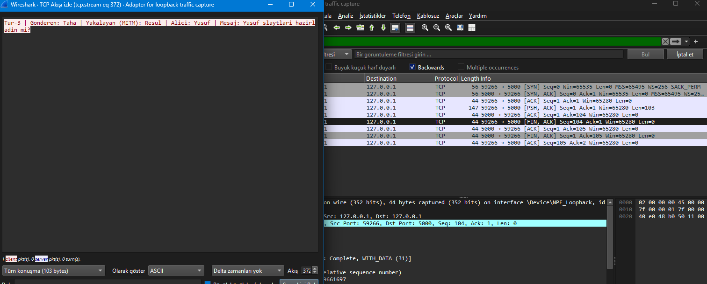

# MITM ve Wireshark Ödevi

**Grup Üyeleri:** Taha, Resul, Yusuf

Bu çalışmada 3 kişi arasında dönüşümlü olarak Gönderici, Aradaki Kişi (MITM) ve Alıcı rolleri test edilmiş, aradaki kişinin şifresiz ağ paketlerini nasıl yakaladığı Wireshark ile görüntülenmiştir.

## Rol Dağılımı

| Tur | Gönderen | Aradaki Kişi (MITM) | Alıcı |
| :--- | :--- | :--- | :--- |
| **1. Tur** | Taha | Yusuf | Resul |
| **2. Tur** | Yusuf | Taha | Resul |
| **3. Tur** | Taha | Resul | Yusuf |

## Kod Dosyaları

- `alici.py` — Hedef sunucu (Port 6000)
- `mitm.py` — Araya girip paketi yakalayan ve alıcıya ileten vekil (Port 5000)
- `gonderici.py` — Paketi aradaki kişiye yollayan istemci
- `test_3_tur.py` — 3 turu sırayla çalıştıran test kodu

## Wireshark Ekran Görüntüleri

Wireshark üzerinden yakalanan paketlerin TCP Stream (açık metin) görüntüleri:

### 1. Tur: Taha -> (Yusuf MITM) -> Resul

### 2. Tur: Yusuf -> (Taha MITM) -> Resul

### 3. Tur: Taha -> (Resul MITM) -> Yusuf

