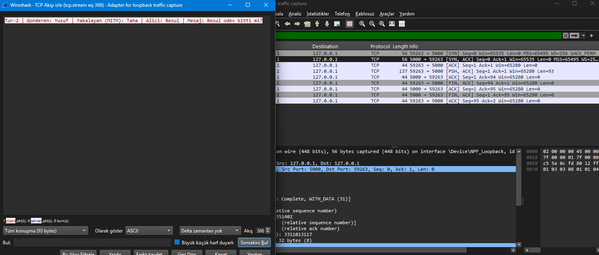
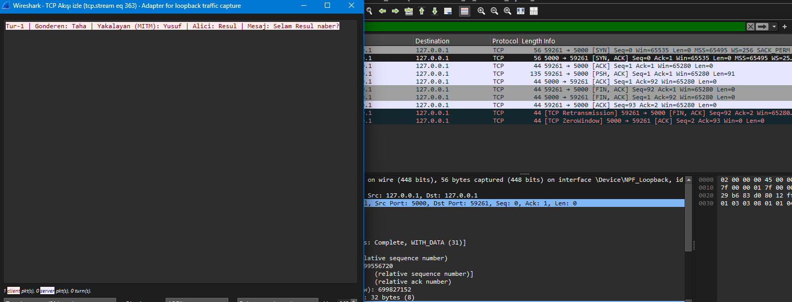

# MITM ve Wireshark Ödevi

**Grup Üyeleri:** Taha, Resul, Yusuf

Bu ödevde 3 kişi arasında Python socket kullanarak basit bir MITM (aradaki adam) simülasyonu yaptık. Birimiz gönderici, birimiz aradaki dinleyici, birimiz de alıcı oldu. 

Paketlerin aradaki kişi tarafından şifresiz olarak nasıl yakalandığını görmek için 3 tur yaptık ve rolleri aramızda değiştirdik:
- **1. Tur:** Taha gönderdi, Yusuf araya girip paketi yakaladı ve Resul'e iletti.
- **2. Tur:** Yusuf gönderdi, Taha araya girip paketi yakaladı ve Resul'e iletti.
- **3. Tur:** Taha gönderdi, Resul araya girip paketi yakaladı ve Yusuf'a iletti.

Ağ trafiğini de Wireshark üzerinden dinleyip TCP akışını (TCP Stream) inceleyerek ekran görüntülerini aldık.

---

## 1. Tur Ekran Görüntüsü (Taha -> Yusuf -> Resul)

## 2. Tur Ekran Görüntüsü (Yusuf -> Taha -> Resul)

## 3. Tur Ekran Görüntüsü (Taha -> Resul -> Yusuf)

